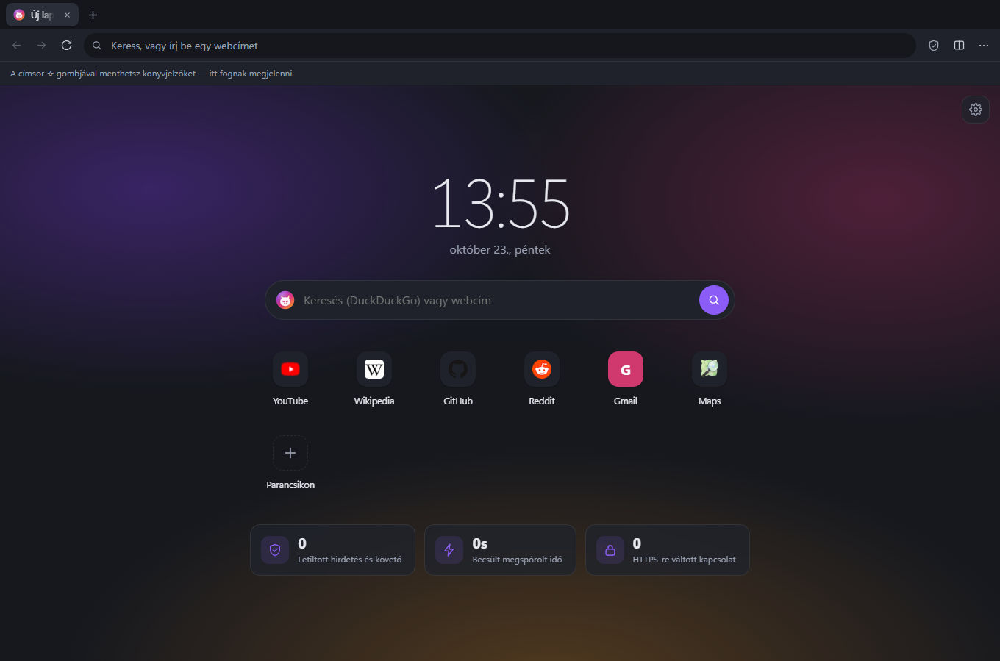

<p align="center">
  
</p>

<h1 align="center">Imp</h1>

<p align="center">
  <b>Gyors. Privát. Könnyű.</b> — Ingyenes, gyors és privát böngésző beépített reklám- és követőblokkolással.<br>
  <i>Fast. Private. Light. — a free, fast and private browser with built-in ad &amp; tracker blocking.</i>
</p>

<p align="center">
  <a href="https://imperiu4s.github.io/imp/"><b>Weboldal / Website</b></a> ·
  <a href="https://github.com/Imperiu4s/imp/releases/latest"><b>Letöltés / Download</b></a>
</p>

<p align="center">
  
</p>

---

## Magyarul

Az Imp a Chromium motorra (Electron 44 / Chromium 152) épülő asztali böngésző, amely a legjobb ötleteket
gyűjti össze a többi böngészőből: a Brave Shieldsét, az Edge alvó lapjait és osztott nézetét, a Vivaldi
gyorsparancsait és függőleges lapjait, a Firefox olvasó módját és HTTPS-only módját, az Opera képernyőképét
és a Chrome feladatkezelőjét.

### Funkciók

- **Imp Shields** – reklám- és követőblokkolás (EasyList/EasyPrivacy alapú Ghostery-motor, YouTube-videóreklámok ellen is), szigorú módban sütifigyelmeztetések elrejtése, oldalanként kikapcsolható, statisztikával.
- **Adatvédelem** – automatikus HTTPS-re váltás (vagy HTTPS-only mód), harmadik féltől származó sütik tiltása, Global Privacy Control, biztonságos DNS (DNS-over-HTTPS), privát ablakok külön munkamenettel.
- **Teljesítmény** – háttérlapok fagyasztása (a nem nézett lapok nem használnak processzort, és újratöltés nélkül folytatódnak), alvó lapok (a háttérlapok felszabadítják a memóriát, ébredéskor megmarad a görgetés és az előzmény), könnyített YouTube, takarékos mód akkumulátoron, „lusta” munkamenet-visszaállítás, előre betöltött új lap, tanuló előcsatlakozás (megjegyzi, mely szerverekről tölt egy oldal, és legközelebb előre kapcsolódik hozzájuk), kikapcsolható hardveres gyorsítás, beépített feladatkezelő.
- **Kényelem** – a weboldalak saját billentyűparancsai elsőbbséget kapnak, okos címsor kiegészítéssel és javaslatokkal, osztott nézet, függőleges lapok, gyorsparancs-paletta (Ctrl+Shift+A), olvasó mód, képernyőkép (látható rész vagy teljes oldal), oldalfordítás, kép a képben, keresés az oldalon, nagyítás oldalanként.
- **Jelszókezelő** – bejelentkezés után felajánlja a jelszó mentését, a bejelentkezési mezőre kattintva kitölti a mentett fiókot (kétlépéses belépésnél is); a jelszavakat az operációs rendszer titkosítja, CSV-importálás és -exportálás (Chrome, Edge, Brave, Firefox, Bitwarden…).
- **Kezelés** – könyvjelzők mappákkal, húzással rendezhető könyvjelzősávval és importálással (Chrome, Edge, Brave, Vivaldi, Opera, HTML), előzmények, letöltési sáv az ablak alján és letöltéskezelő, webhelyengedélyek, HTTP-bejelentkezés, testreszabható új lap.
- **Kétnyelvű** – a teljes felület magyarul és angolul.
- **Automatikus frissítés** a GitHub Releasesből.

### Letöltés

A kész telepítők a [Releases](https://github.com/Imperiu4s/imp/releases/latest) oldalon és a [weboldalon](https://imperiu4s.github.io/imp/) találhatók (Windows `.exe`, macOS `.dmg`, Linux `AppImage`/`.deb`).

> A telepítő nincs digitálisan aláírva, ezért a Windows SmartScreen figyelmeztethet: **További információ → Futtatás mindenképp**.
> macOS-en első indításkor jobb klikk → **Megnyitás**.

### Fejlesztés

Szükséges: [Node.js](https://nodejs.org) 22 vagy újabb.

```bash
npm install        # függőségek telepítése
npm start          # a böngésző indítása fejlesztői módban
npm run check      # szintaxis- és fordításellenőrzés
npm run icons      # ikonok újragenerálása az assets/icon.svg-ből
npm run dist:win   # Windows-telepítő készítése a dist/ mappába
```

Ha az `npm start` azt írja, hogy az Electron nincs telepítve, futtasd: `node node_modules/electron/install.js`.

Tesztprofil használata (a valódi adataidat nem érinti): `IMP_PROFILE=./teszt-profil npm start`.

### Kiadás és weboldal (GitHub)

- **Új verzió kiadása:** tölts fel egy új verziócímkét (a verziószámot a build a címkéből veszi) — a GitHub Actions elkészíti a Windows-, macOS- és Linux-telepítőket, és feltölti őket a [Releases](https://github.com/Imperiu4s/imp/releases) oldalra. A már telepített Impek ebből frissülnek automatikusan.
  ```bash
  git tag v1.0.1
  git push origin v1.0.1
  ```
- **Weboldal:** a `site/` mappa a `main` ágra feltöltve automatikusan kikerül ide: <https://imperiu4s.github.io/imp/>.
  Egyszeri beállítás: *Settings → Pages → Build and deployment → Source: GitHub Actions*.

### Felépítés

```
src/main/      fő folyamat: ablakok, lapok, Shields, előzmények (SQLite), letöltések, frissítés
src/ui/        a böngésző kezelőfelülete (lapsáv, címsor) és a felugró panelek
src/pages/     belső imp:// oldalak: új lap, beállítások, előzmények, könyvjelzők, jelszavak, letöltések, feladatkezelő, olvasó
src/shared/    fordítások (magyar/angol), ikonok, keresőmotorok
build/         telepítő-ikonok és NSIS-beállítások
site/          a letöltő weboldal (GitHub Pages)
.github/       automatikus build, kiadás és weboldal-közzététel
```

---

## English

Imp is a desktop browser built on Chromium (Electron 44 / Chromium 152) that combines the best ideas from other
browsers: Brave-style Shields, Edge-style sleeping tabs and split view, Vivaldi-style quick commands and vertical
tabs, Firefox-style reader view and HTTPS-only mode, Opera-style web capture and a Chrome-style task manager.
The whole interface is available in English and Hungarian.

**Run from source:** `npm install`, then `npm start`. **Build the Windows installer:** `npm run dist:win`.
**Release:** push a tag like `v1.0.0`; GitHub Actions builds Windows, macOS and Linux installers and publishes
them to Releases. The download site in `site/` is deployed to GitHub Pages (Settings → Pages → Source: GitHub Actions).

Not yet supported: Chrome Web Store extensions, sync, a password manager.

## Licenc / License

© 2026 Imperius. Minden jog fenntartva / All rights reserved — lásd / see [LICENSE](LICENSE).

Felhasznált összetevők / Built with: [Electron](https://www.electronjs.org/) / Chromium, the [Ghostery adblocker](https://github.com/ghostery/adblocker) engine (MPL-2.0),
[Mozilla Readability](https://github.com/mozilla/readability) (Apache-2.0), [tldts](https://github.com/remusao/tldts) (MIT)
and [electron-builder](https://www.electron.build/). Browser names mentioned are trademarks of their owners;
Imp is not affiliated with them.
